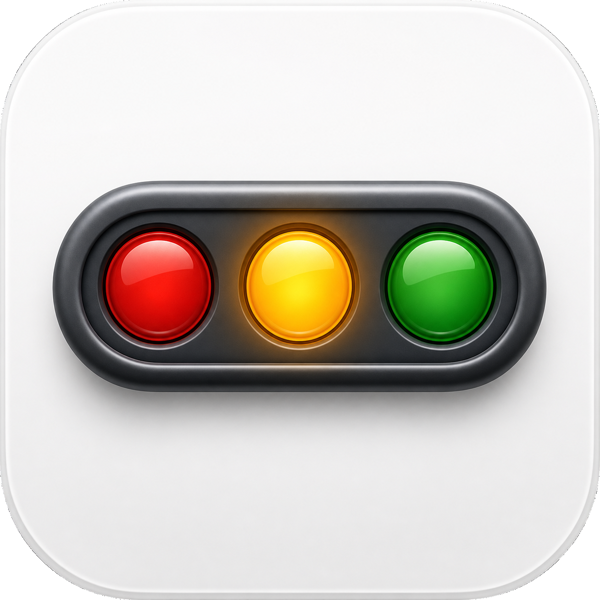
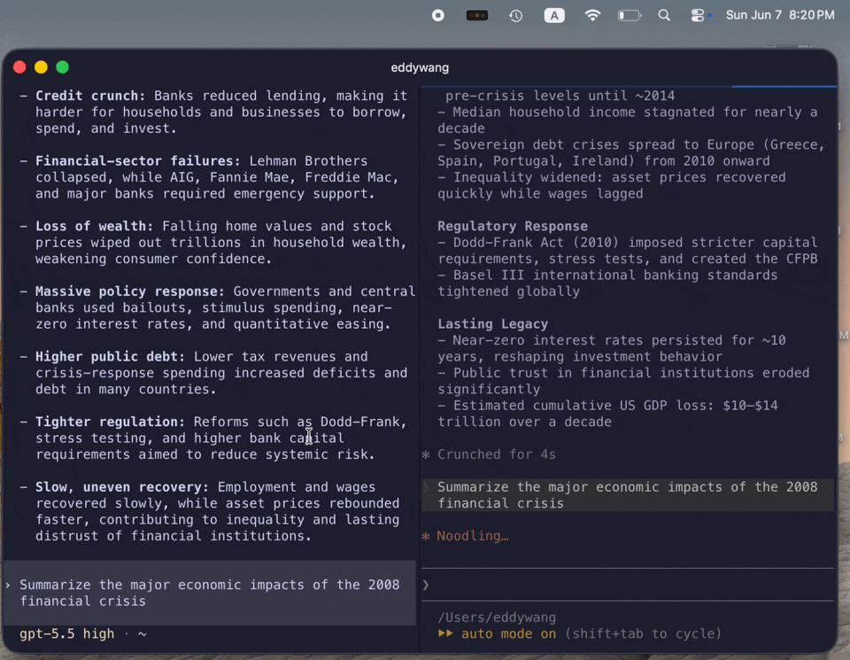

# Agent Light

<p align="center">
  
</p>

<p align="center">
  <a href="https://github.com/eddykwang/agent-light/releases/latest">
    
  </a>
</p>

**Traffic lights for your coding agents, right in the macOS menu bar.**

Keep an eye on local Codex, Claude Code, and GitHub Copilot CLI sessions. See
when work is running, needs your input, finishes, or fails without switching
between terminals.

<p align="center">
  
</p>

- One status panel for multiple agent sessions and projects.
- Optional notifications when agents need attention or finish a turn.
- A floating Desktop Light you can drag, resize, and keep above your windows.
- Horizontal or vertical lights, with launch-at-login support.

## Install

Requires **macOS 14 or later on Apple Silicon**.

```bash
brew tap eddykwang/tap
brew install --cask agent-light
```

Or download the latest ZIP from [Releases](https://github.com/eddykwang/agent-light/releases/latest)
and move `Agent Light.app` to `/Applications`. Current release builds are
Developer ID signed and notarized by Apple.

To update an existing Homebrew installation:

```bash
brew update
brew upgrade --cask agent-light
```

## Use

Open Agent Light and click its menu bar icon to see your sessions. Use
**Settings → Agents** to configure integrations:

| Agent | Setup | Guide |
| --- | --- | --- |
| Codex | Automatic detection; optional lifecycle hooks | [Codex](docs/codex-support.md) |
| Claude Code | Automatic detection; optional hooks for more precise status | [Claude Code](docs/claude-code-support.md) |
| GitHub Copilot CLI | Install hooks, then start a new CLI session | [Copilot CLI](docs/copilot-cli-support.md) |

**Green** means working, **yellow** means input is needed, and **red** means a
failure. Lights dim when agents are idle; gray means the status is unknown.

Codex hooks need a supported runtime (use 0.169 or later) and manual trust in
Codex. Without hooks, Codex and Claude approval prompts may be missed.
Copilot support covers the local CLI.

See the [usage guide](docs/usage.md) for Desktop Light, notifications, custom
configuration directories, and troubleshooting.

## Privacy

Session monitoring stays on your Mac. Agent Light reads local session files and
stores compact status metadata, with no telemetry or model API calls. Optional
hooks do not store prompts, tool arguments, or model responses.

Update checks contact GitHub for release information.

## Contributing

Bug reports and feature requests go in [Issues](https://github.com/eddykwang/agent-light/issues).
For development, use Swift 5.10 or later and Xcode Command Line Tools. From a
local checkout:

```bash
./script/build_and_run.sh run
swift test
```

See [CONTRIBUTING.md](CONTRIBUTING.md) for setup, the full test suite, and pull
request guidance.

## License

[MIT](LICENSE)
