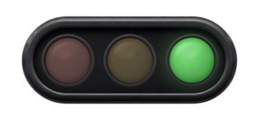
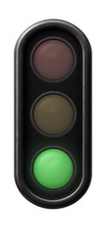

# Using Agent Light

Click the menu bar light to open the status panel. It shows current agent
sessions, their projects, and their latest status. The **Agent integrations**
shortcut opens the provider settings. **Getting Started** reopens onboarding.

## Status colors

| Color | Meaning |
| --- | --- |
| Green | At least one agent is working. |
| Yellow | An agent needs permission or input. |
| Red | An agent reported a failure. |
| Dim/off | Agents are idle or complete. |
| Gray | No current status could be determined. |

When several sessions are visible, failure takes priority over input, then
working, then idle. Detection is best effort; see the provider guides for limits:
[Codex](codex-support.md), [Claude Code](claude-code-support.md),
[Copilot CLI](copilot-cli-support.md).

## Desktop Light

Enable **Desktop Light** in the status panel or **Settings → General → Appearance**.
It mirrors the menu bar status and orientation, and stays above normal windows.

<p align="center">
  
  
</p>

- Drag the housing to reposition it.
- Drag a corner to resize proportionally between 75% and 200%.
- Click the light to open the status panel beside it.
- Right-click and choose **Hide Desktop Light** to dismiss it.

Position, size, and visibility are restored between launches. If a display is
disconnected, the light moves back into the main screen's visible area. It works
across Spaces and full-screen apps while staying below system menus and alerts.

## Notifications and settings

In **Settings → Notification**, choose attention alerts and a completion mode:
**Off**, **Individual**, or **All idle**. macOS notification permission is required.
**Settings → General** controls orientation and launch at login; **Advanced**
lets you change the shared status file, which defaults to
`~/.agent-traffic-lights/status.json`.

Agent Light checks GitHub Releases for updates. Homebrew installations can be
updated with `brew update` followed by `brew upgrade --cask agent-light`.

## Custom configuration directories

| Variable | Replaces | Used for |
| --- | --- | --- |
| `CODEX_HOME` | `~/.codex` | Codex sessions and hook configuration |
| `CLAUDE_CONFIG_DIR` | `~/.claude` | Claude transcripts and settings |
| `COPILOT_HOME` | `~/.copilot` | Copilot hook configuration |

Agent Light and its collector must inherit these variables too. Exporting them
in a terminal does not automatically pass them to an app launched from Finder.
For example, quit Agent Light and launch it with an explicit Codex directory:

```bash
open -n --env CODEX_HOME=/absolute/path/to/codex "/Applications/Agent Light.app"
```

Hook status metadata still lives under `~/.agent-traffic-lights/`.

## Troubleshooting

- **A session is missing:** check the provider guide and make sure Agent Light
  sees the same configuration directory as the agent.
- **Permission/input status is missing:** enable the optional Codex or Claude
  hooks. Codex also requires review and trust of the exact hook definitions.
- **Hooks stopped after moving the app:** reinstall or repair them from
  **Settings → Agents** so their commands point at the current app. Review changed
  Codex hooks again; restart older Claude or Copilot sessions as needed.
- **Notifications do not appear:** check both Agent Light's notification settings
  and its permission in macOS System Settings.

For other problems, [open an issue](https://github.com/eddykwang/agent-light/issues)
with a minimal reproduction and version information.
